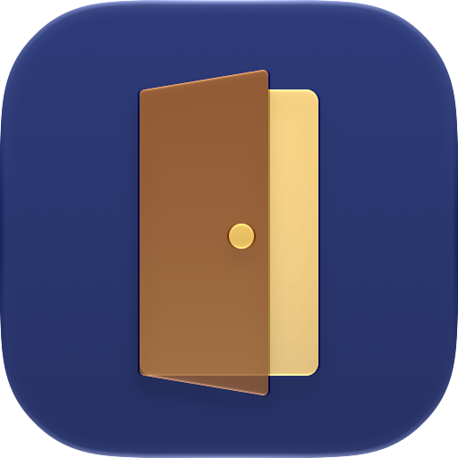

<p align="center">
  
</p>

<h1 align="center">Duor</h1>

<p align="center">
  <a href="https://apps.apple.com/app/duor-advanced-door-simulator/id6829698448"></a>
</p>

<p align="center">
  <a href="LICENSE"></a>
</p>

A door simulator for the foldable **iPhone Duo**, now open source. The phone is the door:

- **Folded:** the cover display shows the outside of a door. Tap to knock.
- **Unfold:** the latch clicks and the door creaks open, following the hinge.
- **Fold:** the door closes with a click, or slams if you're quick about it.

Pick from six doors (oak, cottage, barn, castle, spaceship, metal), five hardware metals, and six living scenes behind the door. See the [solution design](docs/SOLUTION_DESIGN.md).

Duor is [available on the App Store](https://apps.apple.com/app/duor-advanced-door-simulator/id6829698448), made by the [Open Systems Foundation](https://opensf.foundation/products/duor/). The full source, including the sound synthesizer, is open under the Apache 2.0 license.

## Requirements

- Xcode 27.1+ (iOS 27.1 SDK)
- iPhone Duo or the iPhone Duo simulator. On other iPhones (and on the folded Duo) you swipe the door open and shut.

## Getting started

```sh
make run     # build, boot the iPhone Duo simulator, install and launch
make test    # unit tests (Swift Testing)
make lint    # swift-format lint
make format  # swift-format in place
```

Or open `Duor.xcodeproj` and run the **Duor** scheme on *iPhone Duo*.

Fold the simulator using Xcode's Device Hub, or with the [hinge CLI](https://github.com/artemnovichkov/hinge):

```sh
hinge close              # fold shut → cover display
hinge sweep 0 150 1      # open slowly → creak
hinge sweep 150 0 0.15   # close fast → slam
```

## Project layout

```
Duor/
  App/        App entry, root view (hinge input, view switching)
  Door/       Door logic (interpreter, controller, styles) and door views
  Hinge/      HingeReading — our testable hinge sample type
  Audio/      AVAudioEngine host + DSP/ (the synthesizer)
  Settings/   Settings sheet
  Resources/  Assets, string catalog, privacy manifest
DuorTests/    Swift Testing unit tests
Tools/        RenderSounds: offline WAV renderer for the synth
docs/         Solution design
```

The project uses Xcode 27's JSON project format (`Duor.xcodeproj/project.xcproj`). When adding a file, add it to the matching group with the right `target-membership`.

## App Store artwork

`make banner` renders the product page header (3840×1646) and search results image (3840×2560) to `appstore/creative/`, drawn by the app's own living room code with the cat and the dog. Upload them in App Store Connect → the version → Header and Search Results.

## Languages

Duor ships in 15 languages (English plus 14 translations in `Duor/Resources/Localizable.xcstrings`), and its App Store listing in 16 locales. See section 4.6 of the [solution design](docs/SOLUTION_DESIGN.md).

## Sounds

All sounds are synthesized in real time (no audio files): modal resonators for knocks, latches and slams, a stick-slip friction model for the creak, and a small room reverb. See section 6 of the [solution design](docs/SOLUTION_DESIGN.md).

To audition and tune them on your Mac:

```sh
make sounds                          # renders build/sounds/*.wav and prints levels
afplay build/sounds/sequence.wav     # knock knock, open, stop, slam
afplay build/sounds/door-castle.wav  # the same for each door type (oak, pine, barn, castle, spaceship, steel)
```

Tune by editing the presets (`oak`, `pine`, `barn`, `castle`, `spaceship`, `steel`) and `MetalTone` values in `Duor/Audio/DSP/SoundProfile.swift`.

## Contributing

Duor is open source and contributions are welcome: bug reports, new doors, better creaks. Open an issue or a pull request. Before sending a PR, run `make lint` and `make test` (and `make test-audio` if you touched `Duor/Audio/DSP`). Notes on the codebase's conventions are in [CLAUDE.md](CLAUDE.md).

## License

Duor is licensed under the [Apache License, Version 2.0](LICENSE). Copyright 2026 Jeff Kroon. See [NOTICE](NOTICE).

The App Store badge is a trademark of Apple Inc., used per Apple's marketing guidelines.
